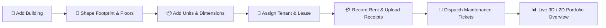

<p align="center">
  
</p>

<h1 align="center">Property Visualizer — Interactive 3D Spatial Property Management & CAD Operations Platform</h1>

<p align="center">
  <strong>Next-Generation Digital Twin Real Estate & Multi-Story Rental Management</strong><br/>
  Interactive Three.js 3D spatial building visualizer, zero-GPU SVG 2D architectural blueprints, automated landlord ledgers, and maintenance ticket operations.
</p>

<p align="center">
  <a href="https://property-visualizer-b04f3.web.app"></a>
  
  
  
  
  
  
  
</p>

---

## About Property Visualizer

**Property Visualizer** is a production-grade digital twin property management platform designed to replace legacy real estate spreadsheets and disjointed SaaS tools. Built from the ground up for multi-story buildings, dormitories, and commercial rental facilities, it bridges physical building architecture with real-time financial, maintenance, and tenancy operations.

* **For Landlords & Property Owners:** Visually inspect portfolio occupancy in real-time 3D, isolate delinquent units with color-coded spatial pins, review net monthly revenue, and track tenant security deposits and digital lease documents.
* **For Building Caretakers & On-Site Managers:** Switch instantly to an ultra-lightweight SVG 2D architectural blueprint on low-spec tablets, log room-specific maintenance tickets, settle on-site errands, and manage staff schedules.
* **For Field Operations:** Works natively as an installed Progressive Web App (PWA) on iPads and iPhones, downleveled to support older WebKit engines without frame drops or syntax crashes.

The platform enforces a strict, intentional visual philosophy: a clean, high-density **Light Mist ledger** (`#f4f4f5`) for financial clarity, paired with an immersive **Obsidian dark CAD environment** (`#0b0f13`) for spatial 3D/2D building exploration.

---

## Why Property Visualizer?

* **Spatial Digital Twin:** Understand your buildings as physical spaces. Unit status, maintenance emergencies, and occupancy are projected directly onto 3D floors rather than buried in tabular rows.
* **Dual-Engine Architecture:** Seamlessly toggle between a full WebGL 3D model (Three.js / React Three Fiber) and a zero-GPU 2D Architectural Blueprint (pure SVG). Older devices or low-bandwidth connections automatically fail over to 2D without interruptions.
* **Production Multi-Tenant Security:** Granular Firestore and Firebase Storage security rules enforce data isolation at the document level (`resource.data.user_id == request.auth.uid`), shielding private tenant documents, contracts, and revenue records.
* **Zero-Lag Field Performance:** Downleveled for iOS/iPadOS Safari 14+, clamped at 60 FPS with low-overhead canvas DPR, client-side photo compression (< 600 KB), and local auth persistence that survives browser sleep.
* **Unified Tenancy & Maintenance Ecosystem:** Maintenance tickets link directly to individual unit IDs, automatically surfacing warning wrench badges on the 3D building and forwarding repair costs to the tenant ledger.

---

## Platforms Supported

### Progressive Web App (PWA) & Mobile
* **Target Devices:** iPad (including legacy iPad Air 2 / iPadOS 14+), iPhone, Android tablets, and phones.
* **PWA Standalone Mode:** Can be added directly to the Home Screen (`display: standalone`) for a native, URL-bar-free interface with custom status bar theming (`#0b3860`).
* **In-App Cache Busting:** Dedicated "Reload App" utility in Settings that purges active service workers and `window.caches` so home-screen users can immediately receive new deployments.

### Desktop & Workstation CAD
* **Target Browsers:** Chrome, Safari, Edge, Firefox.
* **Dual Viewport Layout:** Responsive sidebar (25% on tablets, collapsible on laptops) maximizing spatial viewport area for floor plan inspection.

---

## Core Features & Modules

### 1. Interactive 3D Spatial Visualizer
* **Full Orbit & Pan Controls:** OrbitControls with constrained azimuth and inclination for smooth building inspection.
* **Floor Level Slicing:** Isolate individual levels (`Floor 1`, `Floor 2`, `Floor 3`, or `All Floors`) to inspect indoor layouts without roof obstruction.
* **Raycasted Unit Selection:** Click or tap any 3D room volume to spotlight the unit, rotate the camera, and open the slide-out tenant management drawer.
* **Live Occupancy Status Materials:**
  * 🟢 **Occupied (`#10b981` Emerald):** Active lease, tenant assigned.
  * 🔴 **Overdue (`#f43f5e` Rose):** Rent past due date with automated missed-month alerts.
  * ⚪ **Vacant (`#64748b` Slate):** Open room ready for occupancy.
  * 🔧 **Maintenance Badge:** Animated indicator pinpointing active repair tickets in 3D space.

### 2. Zero-GPU 2D Architectural Blueprint Engine
* **Pure SVG Floorplans:** Renders architectural floor plans to scale with accurate wall outlines, door sweeps, and room dimensions (e.g., `2.6m × 3.2m`).
* **Hardware-Accelerated Touch Navigation:** Smooth pinch-to-zoom, pan, and view reset optimized for touch screens.
* **Automated WebGL Fallback:** Automatically activates when WebGL 2 contexts fail or when low-power mobile mode is detected.
* **Tenant Spotlight Search:** Real-time search filter highlighting matching units and tenants across the active floor plan.

### 3. In-Scene Footprint & Room Editor
* **Interactive Footprint Handles:** Modify building perimeter geometry in real time by dragging vertex handles.
* **Safety Constraints:** Built-in self-intersection prevention and 0.5-unit grid snapping.
* **Architectural Archetypes:** Quick-start geometric templates including Rectangle, L-Shape, and Offset-Z configurations.

### 4. Tenancy Triad & Financial Ledger
* **Unit Operations Panel:** Slide-out management drawer for inspecting tenant profiles, lease contracts, and payment histories.
* **Payment Settlement:** Record monthly rent, utilities, deposits, and maintenance surcharges with automated payment method tagging (Cash, GCash, Bank Transfer).
* **Digital Receipt Vault:** Upload proof-of-payment screenshots directly to Firebase Storage with automatic client-side JPEG compression.
* **Missed-Month Detection:** Automated computation of overdue rent balances based on lease start dates and payment milestones.

### 5. Maintenance Ticket Dispatch
* **Issue Lifecycle:** Log tickets (`Open`, `In Progress`, `Resolved`) with priority levels (`Routine`, `Urgent`, `Emergency`).
* **Unit Association:** Pin issues to specific rooms to project alerts onto the 3D model.
* **Cost Accounting:** Attach repair expenses to tickets and optionally forward charges directly to the unit's financial ledger.

### 6. Staff Payroll & On-Site Errands
* **Staff Directory:** Track on-site personnel (caretakers, technicians, security) with pay rates (hourly or monthly).
* **Errand Dispatch:** Assign building errands (e.g., cleaning, plumbing checks, meter reading) with task completion tracking.

---

## Technical Architecture

### Project Structure

```
property-visualizer/
├── src/
│   ├── app/                      # Next.js App Router
│   │   ├── layout.js             # Root HTML shell, PWA metadata, error banner
│   │   ├── page.js               # Primary app state machine & view router
│   │   └── globals.css           # Tailwind CSS directives & hardware animations
│   ├── components/               # Core application modules
│   │   ├── Visualizer3D.jsx      # Three.js / React Three Fiber canvas & controls
│   │   ├── Blueprint2DView.jsx   # SVG 2D architectural blueprint floorplan engine
│   │   ├── UnitPanel.jsx         # Slide-out tenant ledger & payment manager
│   │   ├── FootprintEditor.jsx   # 3D building geometry vertex manipulator
│   │   ├── RoomLayoutEditor.jsx  # Room partitioning & dimension editor
│   │   ├── Sidebar.jsx           # Responsive collapsible navigation (25% iPad layout)
│   │   ├── BottomNav.jsx         # Mobile-first bottom action bar
│   │   ├── Login.jsx             # Firebase Auth authentication modal
│   │   ├── ErrorBoundary.jsx     # WebGL and runtime crash resilience boundaries
│   │   └── views/                # Primary application screens
│   │       ├── DashboardOverview.jsx   # Portfolio KPIs, occupancy rings, activity
│   │       ├── PropertiesList.jsx      # Property catalog with occupancy bars
│   │       ├── PropertyDetail.jsx      # Deep-dive property hub
│   │       ├── SettingsTab.jsx         # Landlord profile & PWA cache-buster
│   │       └── tabs/                   # Sub-tabs for PropertyDetail
│   │           ├── PropertyOverviewTab.jsx # Building statistics & quick actions
│   │           ├── MaintenanceTab.jsx      # Maintenance tickets & triage
│   │           ├── StaffTab.jsx            # Staff directory & errands
│   │           └── DocumentsTab.jsx        # Lease contract & blueprint vault
│   ├── context/
│   │   └── AuthContext.jsx       # Firebase Auth reactive session provider
│   ├── hooks/
│   │   └── useFirestore.js       # Real-time Firestore listeners, queries & mutations
│   └── lib/
│       ├── firebase.js           # Firebase singleton with memoryLocalCache
│       ├── imageUtils.js         # Client-side image compression pipeline
│       ├── footprints.js         # 3D extrusion geometry algorithms
│       └── textureGenerator.js   # Procedural canvas textures for 3D surfaces
├── scripts/
│   ├── fix_safari_chunks.mjs     # Post-build Turbopack downleveling for Safari 14+
│   ├── bench_render.mjs          # Headless WebGL render performance benchmarks
│   └── ...                       # Video capture & motion graphics automation
├── public/                       # Static branding, textures & PWA assets
│   ├── branding/                 # Vector and high-res brand logos
│   ├── textures/                 # PBR textures (brick, concrete, wood, carbon)
│   └── manifest.json             # PWA web manifest
├── firebase.json                 # Firebase Hosting, Firestore, and Storage deployment
├── firestore.rules               # Multi-tenant security rules with user-scoped isolation
├── storage.rules                 # Cloud Storage ownership isolation rules
└── next.config.mjs               # Next.js configuration with static export
```

### Technology Stack

| Layer | Technology | Purpose |
|---|---|---|
| **Framework** | Next.js 16 (App Router) | Static export pipeline (`output: 'export'`) for Firebase Hosting |
| **UI Library** | React 19 | Component hierarchy, transitions, and concurrent rendering |
| **3D Engine** | Three.js (r185) | WebGL rendering, meshes, lighting, shadows, raycasting |
| **React 3D** | React Three Fiber (v9) & Drei (v10) | Declarative 3D scene graph, OrbitControls, in-canvas HTML pins |
| **2D Floorplans** | Custom SVG Engine | Zero-GPU architectural blueprints with touch pan/zoom |
| **Styling** | Tailwind CSS v4 | Obsidian dark mode (`#0b0f13`) & Light Mist ledger (`#f4f4f5`) |
| **Icons** | Lucide React | High-density icon set across desktop and mobile UI |
| **Backend & Sync** | Firebase Firestore (v12) | Real-time multi-tenant document listeners and transactions |
| **Authentication** | Firebase Auth | Synchronous local persistence (`browserLocalPersistence`) |
| **Cloud Storage** | Firebase Storage | Tenant contracts and receipts with client-side compression |
| **Compression** | browser-image-compression | Client-side JPEG optimization (< 600 KB, max 1400px) |
| **Hosting** | Firebase Hosting | Global CDN with custom cache-control headers |

### Firestore Database Schema

```
/buildings/{buildingId}
  ├── name: string
  ├── address: string
  ├── user_id: string (owner UID)
  ├── floors: number
  ├── footprint: array<[x, y]>
  ├── /units/{unitId}
  │     ├── unit_number: string
  │     ├── floor: number
  │     ├── status: "occupied" | "vacant" | "overdue"
  │     ├── rent_amount: number
  │     ├── tenant_name: string
  │     ├── tenant_phone: string
  │     ├── lease_start: timestamp
  │     ├── lease_end: timestamp
  │     ├── payments: array<PaymentObject>
  │     └── user_id: string
  └── /documents/{docId}
        ├── name: string
        ├── file_url: string
        └── upload_date: timestamp

/maintenance/{ticketId}
  ├── building_id: string
  ├── unit_id: string
  ├── user_id: string
  ├── title: string
  ├── description: string
  ├── priority: "routine" | "urgent" | "emergency"
  ├── status: "open" | "in_progress" | "resolved"
  ├── cost: number
  └── created_at: timestamp

/staff/{staffId}
  ├── user_id: string
  ├── name: string
  ├── role: string
  ├── phone: string
  ├── salary: number
  └── pay_type: "monthly" | "hourly"

/errands/{errandId}
  ├── user_id: string
  ├── title: string
  ├── staff_id: string
  ├── status: "pending" | "completed"
  └── due_date: timestamp

/users/{userId}
  ├── email: string
  ├── display_name: string
  └── settings: object
```

---

## Installation & Setup

### Prerequisites

* **Node.js:** 18.x or 20.x
* **npm:** 9.x or higher
* **Firebase CLI:** `npm install -g firebase-tools`
* **Git:** For cloning the repository

### 1. Clone the Repository

```bash
git clone https://github.com/samuelordialeseya/property-visualizer.git
cd property-visualizer
npm install
```

### 2. Configure Firebase

Create a project in the [Firebase Console](https://console.firebase.google.com/), then enable:
1. **Authentication** (Email/Password or Anonymous)
2. **Cloud Firestore**
3. **Cloud Storage**
4. **Firebase Hosting**

Create a `.env.local` file in the root directory (or update `src/lib/firebase.js`):

```env
NEXT_PUBLIC_FIREBASE_API_KEY=your_api_key
NEXT_PUBLIC_FIREBASE_AUTH_DOMAIN=your_project_id.firebaseapp.com
NEXT_PUBLIC_FIREBASE_PROJECT_ID=your_project_id
NEXT_PUBLIC_FIREBASE_STORAGE_BUCKET=your_project_id.firebasestorage.app
NEXT_PUBLIC_FIREBASE_MESSAGING_SENDER_ID=your_sender_id
NEXT_PUBLIC_FIREBASE_APP_ID=your_app_id
```

### 3. Deploy Security Rules & Composite Indexes

```bash
# Login to Firebase
firebase login

# Select your project
firebase use your_project_id

# Deploy Firestore security rules and storage rules
firebase deploy --only firestore:rules,storage
```

---

## Running the App

### Development Server

```bash
npm run dev
```

Open [http://localhost:3000](http://localhost:3000) in your browser.

### Production Build & Downleveling

The production build script automatically compiles Next.js to static files (`out/`) and runs the Safari downleveling script to eliminate ES2022 compatibility errors on legacy WebKit:

```bash
npm run build
```

### Deploy to Firebase Hosting

```bash
firebase deploy --only hosting
```

Your app will be live at `https://your_project_id.web.app`.

---

## End-to-End Workflow



1. **Building Onboarding:** Create a building, configure its total floor count, and draw or pick an architectural footprint.
2. **Spatial Modeling:** The building renders in real-time 3D. Add rooms, set dimensions, and assign room numbers.
3. **Tenancy Assignment:** Allocate tenants to specific units with monthly rental rates, security deposits, and contract dates.
4. **Financial Settlement:** As tenants pay, record transactions and upload receipt photos with automatic client-side compression. Overdue rent triggers automatic red alerts.
5. **Issue Resolution:** On-site caretakers log repair tickets tagged to specific units, creating immediate spatial indicators on the 3D building and 2D floorplan.
6. **Portfolio Health:** Landlords inspect total occupancy, overdue accounts, and net cash flow at a glance.

---

## Feature Comparison Matrix

| Feature | 3D Spatial Canvas | 2D Blueprint Mode | Ledger & Management |
|---|:---:|:---:|:---:|
| **Interactive Spatial Slicing** | Yes (Floor Slices) | Yes (Floor Switcher) | — |
| **Occupancy Status Colors** | Yes (Real-time PBR) | Yes (SVG Fills) | Yes (Status Badges) |
| **Maintenance Wrench Pins** | Yes (3D Pins) | Yes (SVG Badges) | Yes (Ticket List) |
| **Touch Pan & Zoom** | OrbitControls | Native SVG Matrix | Standard Scroll |
| **Room Measurement Labels** | On Unit Pick | Always Visible | Detailed View |
| **Tenant Photo & Lease Ledger** | Drawer Panel | Drawer Panel | Full Screen |
| **Low-End Mobile & Safari 14+** | Optimized (1.5 DPR) | **Ultra-Smooth (Zero GPU)** | Fully Supported |
| **PWA Standalone Mode** | Supported | Supported | Supported |

---

## Why This Project Stands Out

### 1. Digital Twin Architecture for Real-World Landlords
Unlike abstract spreadsheets or generic property management software, Property Visualizer anchors all financial and operational metrics to physical space. Owners understand building health intuitively through spatial cues.

### 2. Dual-Engine Resilience
3D graphics can be demanding on older mobile devices or low-bandwidth connections. The dual-engine architecture ensures that any device incapable of WebGL 2 rendering falls back gracefully to a responsive, vector-sharp 2D Architectural Blueprint without losing functionality.

### 3. Production Multi-Tenant Security
Every query is scoped strictly by authenticated user IDs. Cross-landlord data leaks are blocked at the Firestore rule level, safeguarding confidential tenant contracts, contact information, and cash flow records.

### 4. Field-Hardened Mobile Performance
Designed for on-site caretakers walking property corridors with tablets. Touch-optimized gestures, offline-resilient auth persistence, image compression, and post-build WebKit downleveling ensure the app works in the field without crashing.

---

## Key Components Reference

| File | Purpose |
|---|---|
| `src/app/page.js` | Top-level app state manager handling active views, selected buildings, and responsive layouts |
| `src/components/Visualizer3D.jsx` | Three.js / React Three Fiber canvas, camera controls, floor level slicing, and raycasting |
| `src/components/Blueprint2DView.jsx` | High-performance SVG 2D architectural blueprint floorplan engine with touch zoom/pan |
| `src/components/UnitPanel.jsx` | Slide-out tenant ledger, payment records, missed-month detection, and photo uploads |
| `src/components/FootprintEditor.jsx` | In-scene polygon vertex manipulation with collision checks and grid snapping |
| `src/components/views/DashboardOverview.jsx` | Portfolio analytics, occupancy progress rings, and quick-action launcher |
| `src/components/views/PropertiesList.jsx` | Searchable building directory with visual occupancy bars and status filters |
| `src/hooks/useFirestore.js` | Real-time Firestore hooks for buildings, units, maintenance tickets, and staff |
| `src/lib/imageUtils.js` | Client-side compression pipeline scaling photos to < 600 KB before upload |
| `scripts/fix_safari_chunks.mjs` | Automated build pipeline downleveling ES2022 static initializers for Safari 14+ |

---

## Author & Repository Details

* **Author:** Samuel Ordiales ([@samuelordialeseya](https://github.com/samuelordialeseya))
* **Repository:** [github.com/samuelordialeseya/property-visualizer](https://github.com/samuelordialeseya/property-visualizer)
* **Live Deployment:** [property-visualizer-b04f3.web.app](https://property-visualizer-b04f3.web.app)

---

## License

This project is licensed for proprietary property management operations. All rights reserved.

---

<p align="center">
  <strong>Property Visualizer</strong><br/>
  Next-generation digital twin property management & spatial operations. 🏢
</p>
